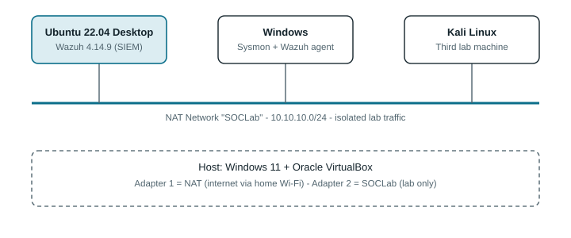
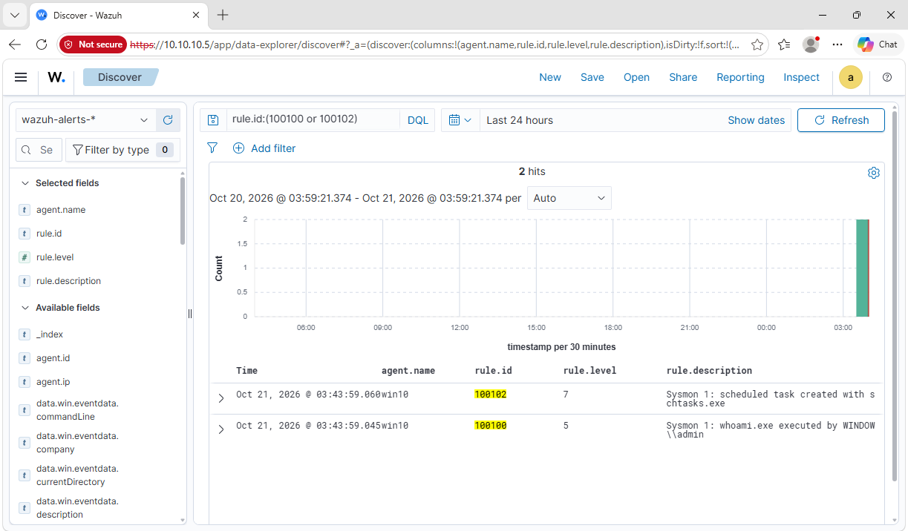

# My Home SOC Lab

I built a tiny security operations center on my own PC, broke a few things on the way,
fixed them, and wrote it all down so you don't have to suffer the same way.

## What is it?

Three virtual machines in an isolated network:

- **Wazuh** (Ubuntu): the "brain" that collects logs and shouts when something looks odd. It runs in the background like a small server, and I open its dashboard from the Windows VM's browser.
- **Windows + Sysmon**: the machine being watched. Sysmon tells Wazuh everything it does.
- **Kali**: set up on the lab network, not used for anything yet.

I run harmless commands on the Windows VM and watch what Wazuh says about them.

## Proof it works

Two custom detection rules I wrote, firing in the Wazuh dashboard:

| Rule | Catches | MITRE ATT&CK |
|---|---|---|
| 100100 | `whoami.exe` running | T1033 |
| 100102 | A scheduled task being created | T1053.005 |

## What I learned

I wrote four rules and kept two. For the other two, Wazuh already had built-in rules that
fired first. Check what the tool already does before reinventing it.

## The journey

| Part | What |
|---|---|
| 1 | [Lab setup](docs/01-lab-setup.md) |
| 2 | [Detection rules](docs/02-detection-rules.md) |
| 3 | [Investigation write-ups](docs/03-investigations.md) |
| 4 | [Lessons learned](docs/04-lessons-learned.md) |

## Built with

VirtualBox, Ubuntu 22.04, Wazuh 4.14.9, Sysmon with the SwiftOnSecurity config, Kali Linux.

No passwords or keys are in this repo. The lab network (`10.10.10.0/24`) only exists
inside my PC.
