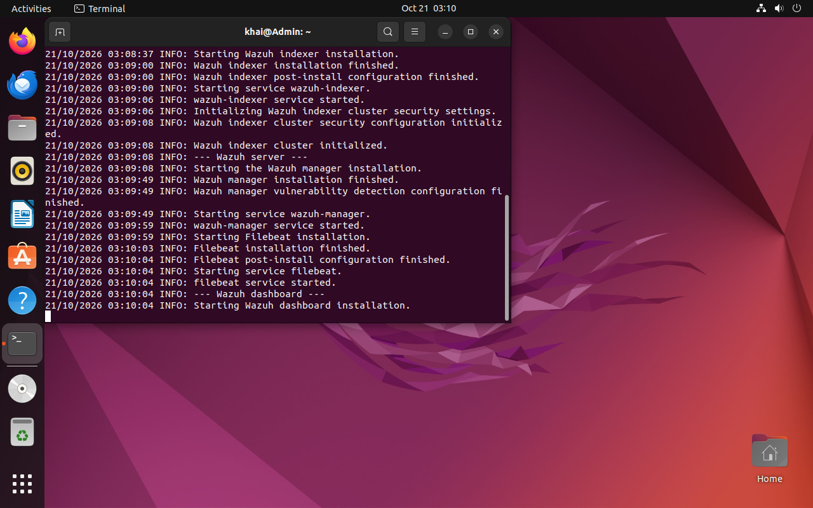
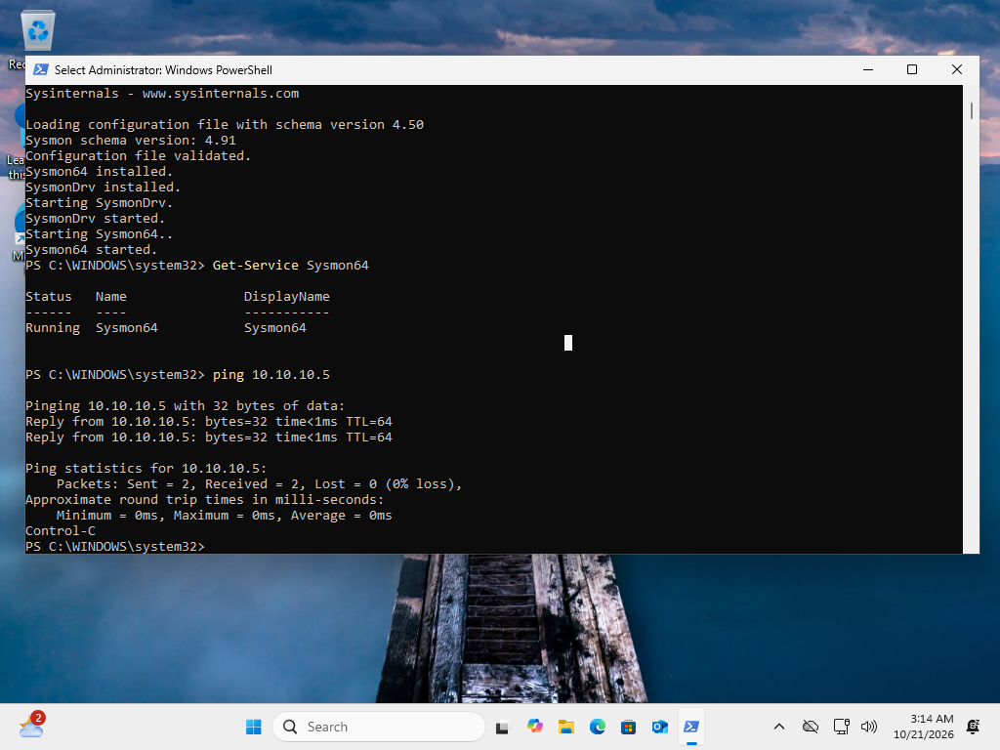
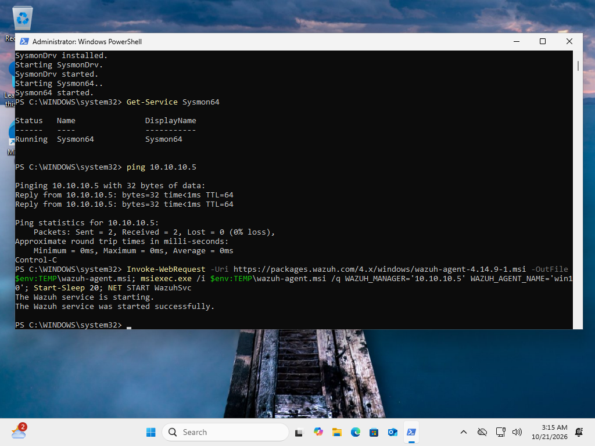
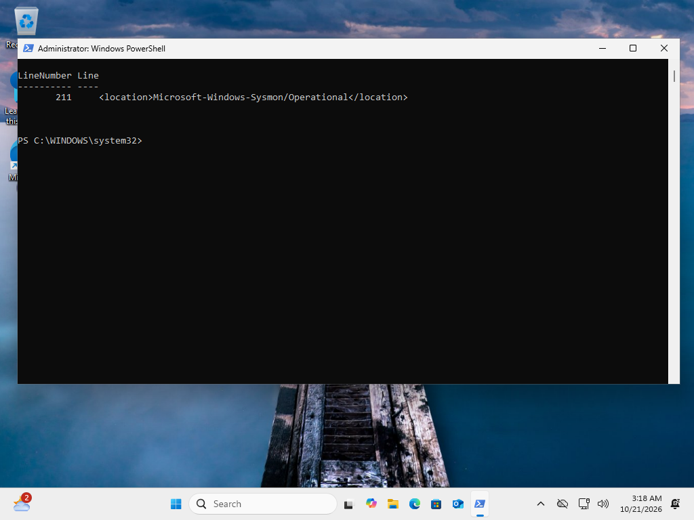
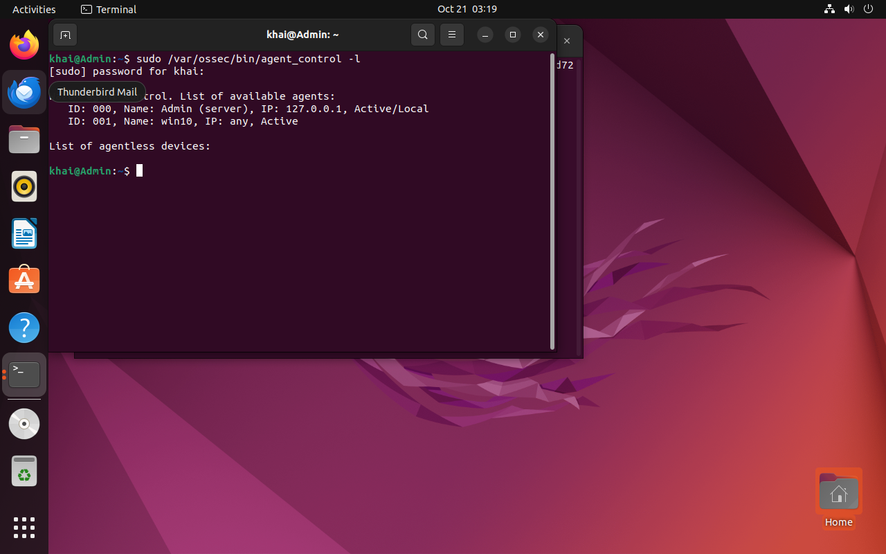
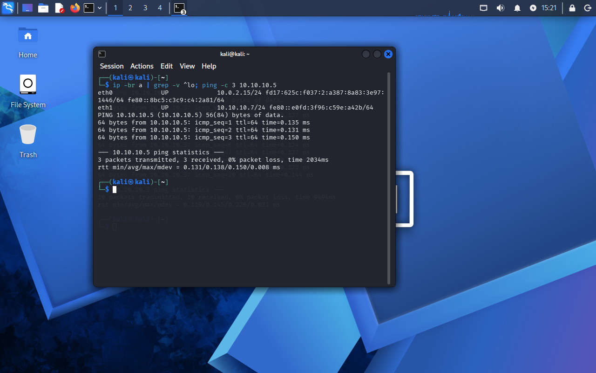

# Part 1: Lab setup

Three VMs, one network, zero patience required (okay, a little).


| VM | Job | Size |
|---|---|---|
| Ubuntu 22.04 | Wazuh: the brain | 8 GB RAM, 4 CPU, 60 GB disk |
| Windows | The machine being watched (Sysmon + Wazuh agent) | 6-8 GB RAM |
| Kali | Third machine on the lab network | 4 GB RAM |

Every VM gets **two network cards**: one NAT card for the internet, and one on a private
lab-only network (`SOCLab`, `10.10.10.0/24`) so lab traffic stays away from the home Wi-Fi.

## Step 1: the private network

```powershell
VBoxManage natnetwork add --netname SOCLab --network "10.10.10.0/24" --enable --dhcp on
VBoxManage modifyvm "<vm>" --nic1 nat --nic2 natnetwork --nat-network2 SOCLab
```

## Step 2: install Wazuh

Two commands, then a coffee break:

```bash
sudo apt install -y curl
curl -sO https://packages.wazuh.com/4.14/wazuh-install.sh && sudo bash ./wazuh-install.sh -a
```



## Step 3: set up the Windows machine

Sysmon is a free Microsoft tool that records what programs do. Wazuh reads those records.



Then I installed the Wazuh agent, which sends everything to the server:



And told the agent to read Sysmon's log by adding this to its config:

```xml
<localfile>
  <location>Microsoft-Windows-Sysmon/Operational</location>
  <log_format>eventchannel</log_format>
</localfile>
```



## Step 4: does it work?

On the Wazuh server:

```bash
sudo /var/ossec/bin/agent_control -l
```



`win10 ... Active` means the Windows machine is talking to Wazuh. And Kali can reach it too:



## Next

[Part 2: Detection rules](02-detection-rules.md)
