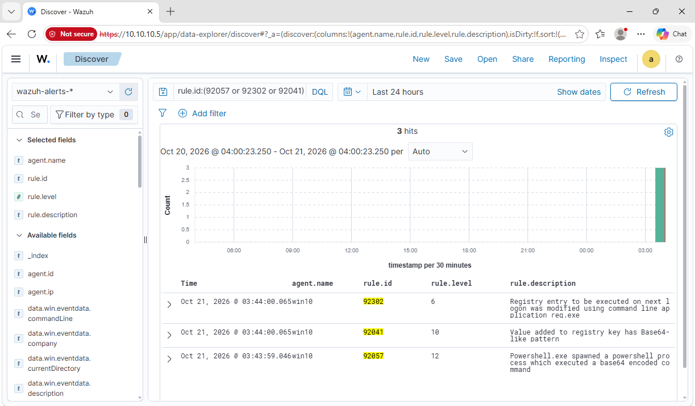

# Part 2: Detection rules

A detection rule is a "if you see this, shout" instruction for Wazuh. I wrote four,
tested them, and kept the two that were actually useful.

The file that runs on my server: [`soclab_rules.xml`](https://github.com/muhdkhairuddinn/soc-home-lab/blob/main/rules/soclab_rules.xml)

## How I tested (safely)

Only harmless, built-in Windows commands, run on my own lab VM, and cleaned up right after.
Nothing touches another machine.

## The two keepers


| Rule | Catches | Level | MITRE ATT&CK |
|---|---|---|---|
| 100100 | `whoami.exe` running | 5 | T1033 (finding out who you are on a machine) |
| 100102 | A scheduled task being created | 7 | T1053.005 (a way to run things again later) |

**100100** in plain words: attackers often type `whoami` first to see who they are.
Admins do too, so it's a low-level clue, not an alarm.

```xml
<rule id="100100" level="5">
  <if_sid>61603</if_sid>
  <field name="win.eventdata.originalFileName" type="pcre2">(?i)^whoami\.exe$</field>
  <description>Sysmon 1: whoami.exe executed by $(win.eventdata.user)</description>
  <mitre><id>T1033</id></mitre>
</rule>
```

Try it yourself: `whoami /all`

**100102** in plain words: a new scheduled task is a classic way to make something come
back after a reboot.

```xml
<rule id="100102" level="7">
  <if_sid>61603</if_sid>
  <field name="win.eventdata.originalFileName" type="pcre2">(?i)^schtasks\.exe$</field>
  <field name="win.eventdata.commandLine" type="pcre2">(?i)/create</field>
  <description>Sysmon 1: scheduled task created with schtasks.exe</description>
  <mitre><id>T1053.005</id></mitre>
</rule>
```

Try it, then clean up:

```powershell
schtasks /create /tn LabDemoTask /tr notepad.exe /sc once /st 23:59 /f
schtasks /delete /tn LabDemoTask /f
```

## The two I deleted (plot twist)

I also wrote rules for **encoded PowerShell commands** and **programs added to the Windows
startup list**. I tested them... and they never fired. Not because they were broken, but
because Wazuh **already ships rules for both**, and those fired first:



| My idea | Wazuh already had |
|---|---|
| Encoded PowerShell | 92057 (level 12) |
| Startup-list change | 92302 (level 6) and 92041 (level 10) |

So I deleted mine. A duplicate rule is just extra noise for whoever reads the alerts.

**Takeaway:** look at what the tool already does before writing your own. Only fill the gaps.
(Neither `whoami` nor `schtasks /create` had a built-in rule, so mine are real additions.)

## What's still to do

- Show the `wazuh-logtest` output for each rule.

## Next

[Part 3: Investigation write-ups](03-investigations.md)
