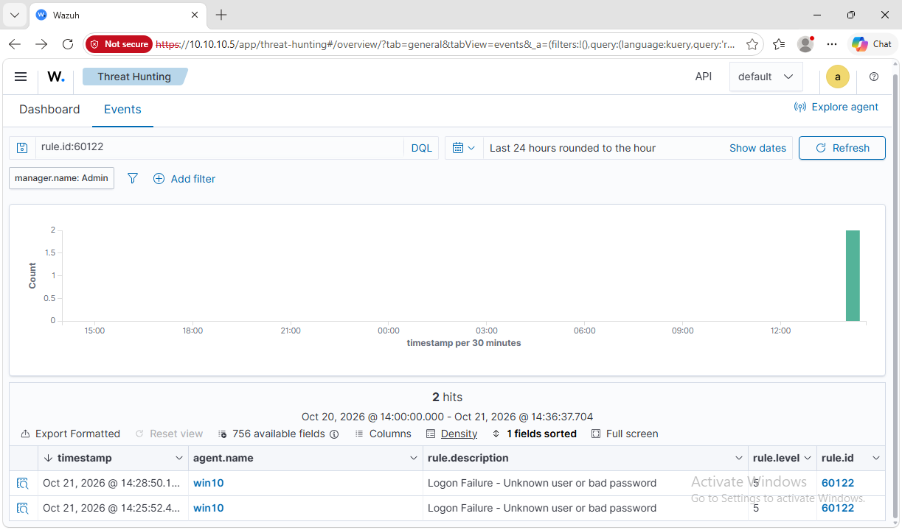

# Part 3: Investigation write-ups

A SOC analyst gets an alert and has to answer four things: what happened, was it normal,
how do I know, and what do I change. Here is my first case, from my own lab VM.

## Case 1: failed Windows logons

**Alert:** rule `60122`, level 5, "Logon Failure - Unknown user or bad password", agent
`win10`. It fired twice, three minutes apart.

### 1. What happened?

Someone tried to sign in as `admin` with a wrong password, twice. I read the raw Windows
Security events (4625 = failed logon, 4624 = successful logon) on the VM to see the details:

| Time | Event | Account | Logon type | Source | Process |
|---|---|---|---|---|---|
| 14:25:53 | 4625 failed | admin | 2 (at the keyboard) | 127.0.0.1 | svchost.exe |
| 14:25:54 | 4624 success | admin | 2 (at the keyboard) | | User32 |
| 14:28:51 | 4625 failed | admin | 3 (over the network) | 127.0.0.1 | none |

Both failures have status `0xc000006a`: the account exists, the password is wrong.

### 2. Was it normal or weird?

Normal, because it was me. I typed a wrong password at the lock screen, and then ran
`net use` with another wrong password to produce the second one.

If I did not know that, these would still point to a harmless cause:

- Only 2 failures in 3 minutes, not dozens.
- Source is `127.0.0.1`, the machine itself. No remote IP.
- The account exists (`0xc000006a`, not `0xc0000064` which means "no such user"). A
  password spray usually hits many accounts.
- A success (4624) for the same account follows within a second of the first failure.

### 3. How do I know?

Two sources agree: Wazuh raised `60122` for both failures, and the Windows Security log
has the matching 4625 events with the same timestamps. The logon type tells the story:
type 2 is someone at the machine, type 3 is the network.

### 4. What would I change?

- Level 5 is fine for one failure. The useful rule is many failures in a short time, so
  I would alert on repeated `60122` from the same source (Wazuh has brute-force rules for
  this) instead of raising the level of single failures.
- For a real incident, a type 3 failure from a **remote** IP, or a success right after a
  long run of failures, would be the signal to escalate.

**Verdict:** false positive, caused by me. No action needed.
