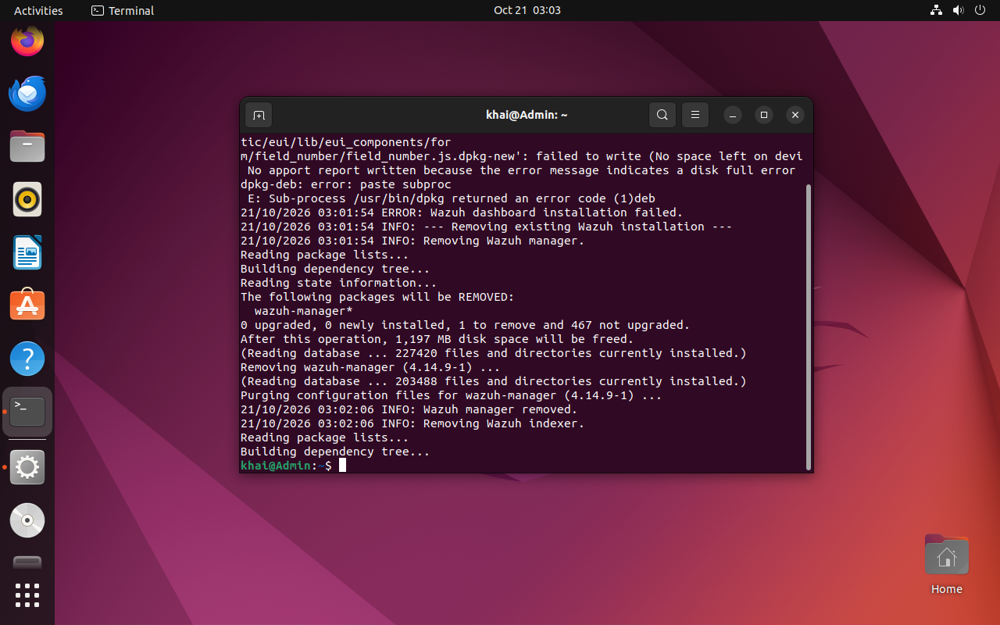

# Part 4: Lessons learned

Or: "everything that broke, and what fixed it."

## The disk filled up and Wazuh gave up

The installer got all the way to the last step, then died and politely uninstalled itself.



The VM disk was only 25 GB. I made it 60 GB and grew the partition:

```bash
sudo apt install -y cloud-guest-utils
sudo growpart /dev/sda 3
sudo resize2fs /dev/sda3
```

Second try worked. **Lesson:** a SIEM eats disk. Give it room.

## Everything was slow (it was the hard disk)

Three VMs installing on a spinning hard drive = a very sad computer. Moving the VM files
to an SSD fixed it. **Lesson:** check where your files live before blaming the CPU.

## Copy-paste refused to work

Two culprits:

- Ubuntu was using **Wayland**, and VirtualBox's clipboard only works on **Xorg**.
- Two different versions of the VirtualBox guest tools were installed and fighting.

Fix: switch to Xorg, keep only one version of the tools, and start the clipboard helper
on login. **Lesson:** match the guest tools to your VirtualBox version.

## The user couldn't use sudo

The auto-installer made my Ubuntu user without admin powers. I fixed it from a live
Ubuntu ISO by mounting the disk and adding the user to the `sudo` group. **Lesson:**
test `sudo whoami` first thing.

## My detection rules were redundant

Covered in [Part 2](02-detection-rules.md). Short version: I wrote rules Wazuh already had.

## Keeping the lab off the home Wi-Fi

Each VM has an internet card and a second card on a private lab-only network. Handy for
the day I run something I don't want anywhere near the family laptop.
