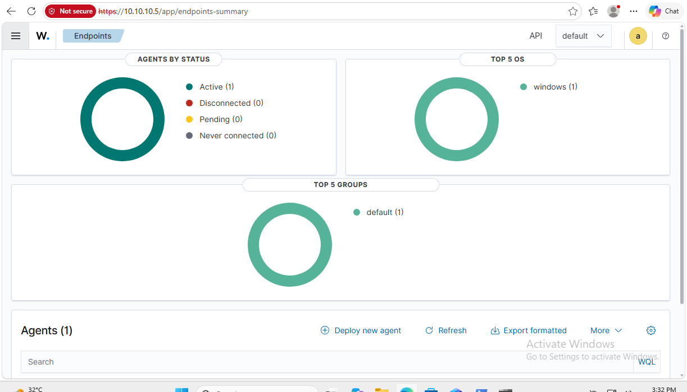
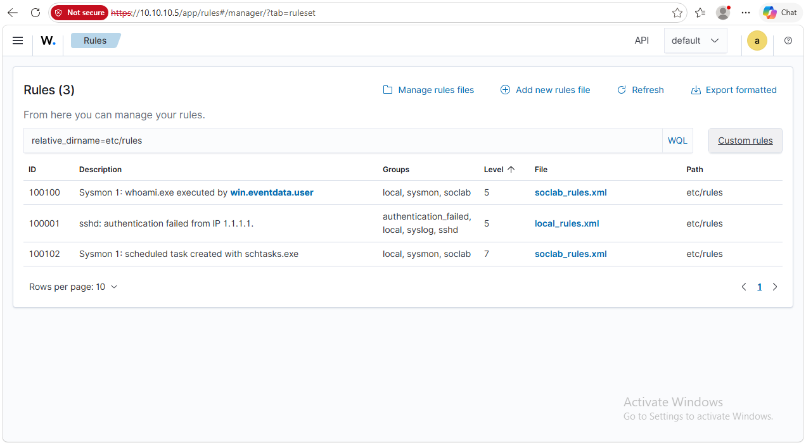
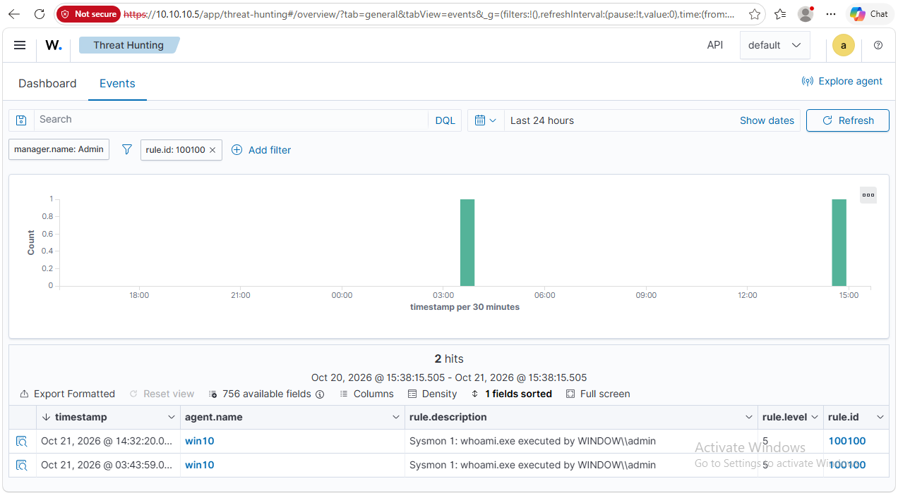

# Day 2: Dashboard tour

Today I walked through the Wazuh dashboard sidebar to learn where everything lives.

## The sidebar, in groups

| Group | What it is for |
|---|---|
| **Home** | Overview of agents and alerts |
| **Explore** | Search and build your own views: Discover, Dashboards, Visualize, Reporting |
| **Endpoint security** | Configuration Assessment, Malware Detection, File Integrity Monitoring |
| **Threat intelligence** | Threat Hunting (the alerts), Vulnerability Detection, MITRE ATT&CK |
| **Security operations** | Compliance dashboards: PCI DSS, GDPR, HIPAA, NIST 800-53 |
| **Cloud security** | Docker, AWS, Google Cloud, GitHub, Office 365. Not used in my lab |
| **Agents management** | The list of agents and groups |
| **Server management** | Rules, Decoders, CDB Lists, Status, Logs, Settings, Ruleset Test |
| **Indexer management** | Storage of alerts, snapshots |

Two things I want to remember: **Ruleset Test** is `wazuh-logtest` in the browser, and **Logs** shows the manager log without a terminal.

## Agents: Endpoints Summary

Four statuses to know: **Active**, **Disconnected**, **Pending**, **Never connected**. My `win10` agent is Active. A Disconnected agent is the first sign that something is wrong, because a machine that stops reporting is a machine I can't see.

Clicking the agent shows its ID (`001`), IP, version, OS, last keep alive, a system inventory (cores, RAM) and its top MITRE tactics. A big alert count is not the same as a big attack: the built-in rules tag normal Windows activity with ATT&CK techniques too.

## Rules: Server management

The Rules page lists all **4,515** built-in rules. My own rules are hidden in there, so I used the **Custom rules** button, which filters to the folder `etc/rules`.

- `100100` and `100102` are mine, from `soclab_rules.xml`.
- `100001` is a sample rule that Wazuh ships in `local_rules.xml`. It only matches SSH logs from `1.1.1.1`, so it never fires here.

Opening `100100` shows the rule as a form that maps to the XML: level, groups, `if_sid` (the parent rule that must match first), the field pattern, and the MITRE technique. Wazuh rules are **chained**: rule `61603` knows "a process was created", and mine adds "and it is `whoami.exe`".

## From rule to alerts

**View alerts of this Rule** jumps to Threat Hunting, filtered to that rule:

Two hits on `win10`: one from my first test, and one from later.

## What I learned

- The sidebar is organized like an analyst's questions: which machines, what happened, what changed, what is weak.
- Always check the agent status first. Disconnected means blind.
- The Rules page shows built-ins by default. Use **Custom rules** to see my own.
- A rule is a form on screen, but it is just XML underneath.
