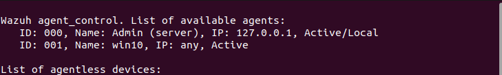
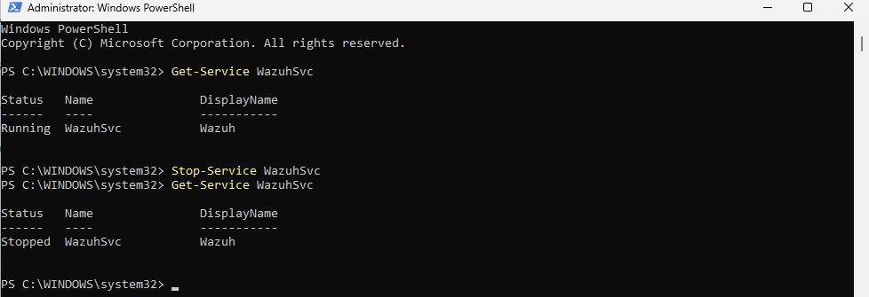
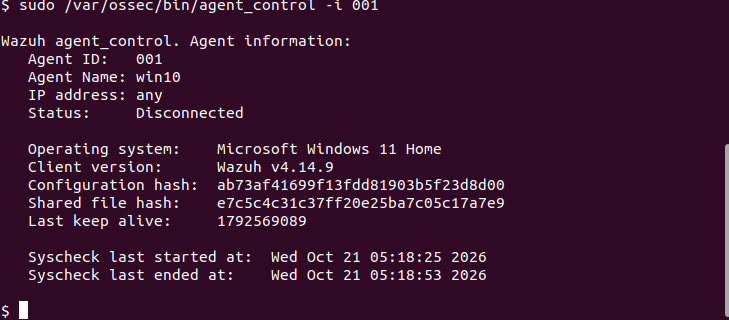
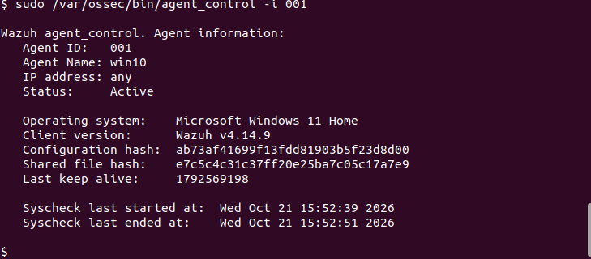
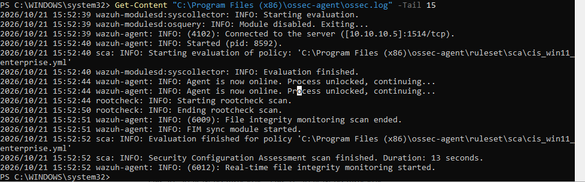

# Day 3: Agents

Today I looked at an agent from both sides, then switched it off and on to see what the server notices.

## The server's view

On the Wazuh server, `agent_control` lists the agents:

```bash
sudo /var/ossec/bin/agent_control -l
```



- `000` is the Wazuh server itself. It monitors itself as an agent.
- `001` is `win10`. `IP: any` means it can connect even if its IP changes.

`agent_control -i 001` shows one agent in detail: status, version, a hash of its config, the **last keep alive** (a Unix timestamp) and the last file-integrity scan.

## Switching the agent off

On the Windows VM, in PowerShell as Administrator:

```powershell
Stop-Service WazuhSvc
Get-Service WazuhSvc
```



A minute or two later, the server marks it **Disconnected**:



The **last keep alive** number froze. Before the stop it moved every minute or so. A frozen keep alive is the first sign that a machine stopped reporting. Attackers often switch off security agents, so Disconnected deserves a look.

## Switching it back on

```powershell
Start-Service WazuhSvc
```

For a few seconds the status is **Pending** (connected, but the server has not finished the handshake). Then it goes **Active**:



The file-integrity scan time also changed: the agent starts a new scan every time it starts.

## Reading the agent log

```powershell
Get-Content "C:\Program Files (x86)\ossec-agent\ossec.log" -Tail 15
```



The important lines: `Connected to the server ([10.10.10.5]:1514/tcp)`, then `Agent is now online`. After that, the agent runs rootcheck, a file integrity scan and a CIS hardening scan on its own.

A typo reminder from today: I left out the `:` in `C:\` and PowerShell treated the path as relative, so it looked inside `C:\WINDOWS\system32\`. A full path needs `C:\`.

## What I learned

- Agent states: **Active**, **Disconnected**, **Pending**, **Never connected**. Pending is a normal step on the way to Active.
- The keep alive is the agent's heartbeat. If it freezes, the machine stopped reporting.
- Starting an agent triggers rootcheck, file integrity monitoring and a hardening scan.
- The agent log (`ossec.log`) is the first place to look when an agent will not connect.
