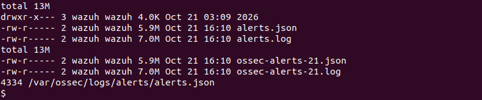
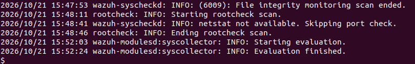
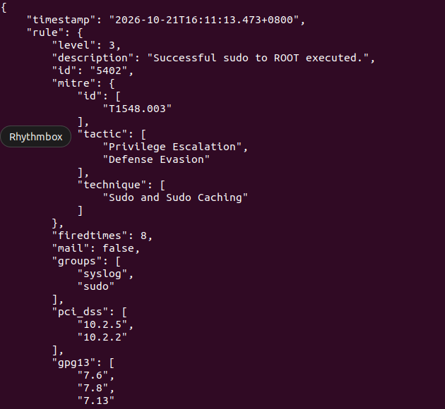

# Day 4: Where Wazuh keeps its logs

Today I explored `/var/ossec`, the home of Wazuh on the server, and read a raw alert.

## Finding my way around

| Command | Meaning |
|---|---|
| `pwd` | Where am I? |
| `ls` | What is in this folder? |
| `cd` | Go to another folder |
| `ls -l` | Long list: permissions, owner, size, date |
| `ls -lh` | Same, with sizes like KB and MB |

`ls /var/ossec` without `sudo` gave `Permission denied`. The folder belongs to the `wazuh` and `root` users, so a normal user can't open it. With `sudo` it works. The folders that matter: `bin` (programs), `etc` (config and my own rules), `ruleset` (built-in rules), `logs` (logs and alerts), `queue` (events waiting to be processed).

## The logs folder

```bash
sudo ls -l /var/ossec/logs
```

| Entry | What it holds |
|---|---|
| `alerts/` | Alerts that were generated |
| `archives/` | Every raw event, only filled when `<logall>` is on |
| `ossec.log` | Wazuh's own log (where to look when something breaks) |
| `api.log` | API requests. The biggest, because the dashboard asks the API all the time |
| `active-responses.log`, `integrations.log` | Empty (0 bytes): I have no automatic responses or integrations yet |

## The alerts folder

```bash
sudo ls -lh /var/ossec/logs/alerts
```



- `alerts.json` is today's alerts, one JSON object per line. `alerts.log` has the same alerts in plain text.
- Old days are stored under `2026/Oct/` as `ossec-alerts-DD.json`.
- `wc -l alerts.json` counted **4,334 alerts** so far today.

## ossec.log

```bash
sudo tail -n 6 /var/ossec/logs/ossec.log
```



`tail -n 6` shows the last 6 lines. These show the file integrity scan ending, a rootcheck scan, and the system inventory collector, with timestamps.

## One raw alert

```bash
sudo tail -n 1 /var/ossec/logs/alerts/alerts.json | python3 -m json.tool | head -32
```



The newest alert was **rule 5402, "Successful sudo to ROOT executed"** (level 3, MITRE T1548.003). It was caused by my own `sudo` commands while exploring. Wazuh was watching the server I was typing on.

## What I learned

- Alerts are plain JSON, one per line, in `alerts.json`. Everything on the dashboard comes from these.
- `ossec.log` is the log to check first when Wazuh misbehaves.
- The server monitors itself too, so my own `sudo` produced an alert.
- Permissions matter: `Permission denied` is a feature.
