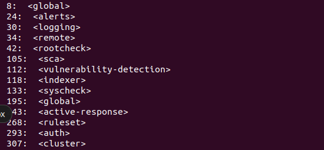
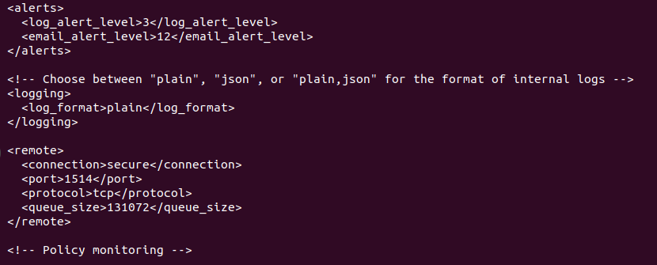

# Day 6: The ossec.conf tour

`/var/ossec/etc/ossec.conf` is the main config of the Wazuh server. Today I read it, section by section, without changing anything.

## The main sections

```bash
sudo grep -nE '<(global|alerts|logging|remote|rootcheck|sca|vulnerability-detection|indexer|syscheck|active-response|ruleset|auth|cluster)>' /var/ossec/etc/ossec.conf
```



| Section | What it controls |
|---|---|
| `<global>` | General behaviour |
| `<alerts>` | The minimum level for storing and emailing alerts |
| `<logging>` | Format of Wazuh's own log |
| `<remote>` | How agents connect to the server |
| `<rootcheck>` | Rootkit checks |
| `<sca>` | Security configuration assessment (Day 16) |
| `<vulnerability-detection>` | Known-vulnerability scans (Day 17) |
| `<indexer>` | Where alerts are sent for storage |
| `<syscheck>` | File integrity monitoring (Day 15) |
| `<active-response>` | Automatic reactions (Day 19) |
| `<ruleset>` | Which rule and decoder folders are loaded |
| `<auth>` | How new agents enroll (port 1515) |
| `<cluster>` | Several servers working together |

## Three blocks in detail

```bash
sudo sed -n '24,41p' /var/ossec/etc/ossec.conf
```



- **`log_alert_level` 3**: only events of level 3 and up become alerts. Levels 0 to 2 are dropped. This is why level 0 rules ("match but don't alert") are quiet.
- **`email_alert_level` 12**: only level 12 and up would send an email (no email is set up).
- **`<remote>`**: connection `secure` (encrypted), port **1514**, protocol **tcp**. This is the port from Day 1.

## Editing safely

The routine I will follow from Day 8 on:

```bash
sudo cp -p /var/ossec/etc/ossec.conf /var/ossec/etc/ossec.conf.bak   # back up first
# edit the file
sudo systemctl restart wazuh-manager                                 # apply
sudo systemctl status wazuh-manager --no-pager                       # check it came back
```

For rules and decoders, test before restarting: `sudo /var/ossec/bin/wazuh-analysisd -t`.

## What I learned

- One XML file, one block per feature. Finding the right block is most of the work.
- `log_alert_level` decides what ever shows up on the dashboard.
- Always back up, edit, test, restart, check.
